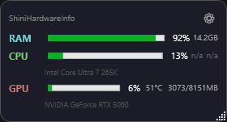

# ShiniHardwareInfo Widget

A lightweight Windows desktop widget that monitors hardware in real time.



## Features

- **RAM**: usage percentage + used/total (GB), with optional extended details (used/free/total).
- **CPU**: usage percentage, temperature, frequency and voltage (when the sensor is available).
- **GPU**: usage percentage, temperature, frequency, voltage and VRAM used/total.
- **Disks**: per-drive used/total/free space with usage bar; choose which disks to show.
- Floating window, always on top, draggable and resizable.
- System tray icon: left double-click or right-click menu to show/hide.
- Configurable: toggle every metric, adjust font size (0.7x–2.0x), window size persisted.
- Self-contained single-file executable (~168 MB, includes .NET 10 runtime). No installation required.

## Requirements

- Windows 10/11 (x64)
- For CPU temperature/frequency: a kernel driver must be able to read the sensor.
  - On many laptops/OEMs, Windows exposes it via WMI and it works out of the box.
  - On desktops with Core Isolation (HVCI) enabled, Windows does not expose CPU temp/freq without a signed driver.
  - Optional: install [HWiNFO64](https://www.hwinfo.com/download/) with "Shared Memory Support" enabled — the widget reads from it automatically.
  - Or disable Core Isolation in Windows Security (reversible, no installation).

The rest of the monitoring (RAM, CPU %, GPU %, VRAM, disks) works on any PC without installing anything.

## Build

Requires .NET 10 SDK.

```powershell
cd ShiniHardwareInfo.Widget
dotnet publish -c Release -r win-x64 --self-contained true -p:PublishSingleFile=true
```

Output: `bin\Release\net10.0-windows\win-x64\publish\ShiniHardwareInfo.Widget.exe`

## Run

Double-click the .exe. The widget appears centered on screen and an icon shows in the system tray.

- Double-click the tray icon (or right-click → "Mostrar / Ocultar") to show/hide.
- Click ⚙ for options: toggle metrics, choose disks, font size, start with Windows, exit.

## License

MIT — see [LICENSE](LICENSE).

## Acknowledgements

- [LibreHardwareMonitor](https://github.com/LibreHardwareMonitor/LibreHardwareMonitor) for hardware sensors.
- [Hardcodet.NotifyIcon.Wpf](https://github.com/hardcodet/wpf-notifyicon) for the system tray icon.
- [Hwinfo.SharedMemory.Net](https://www.nuget.org/packages/Hwinfo.SharedMemory.Net) for HWiNFO shared memory support.
